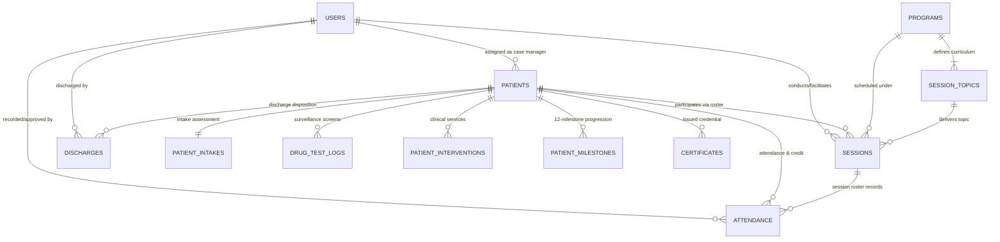
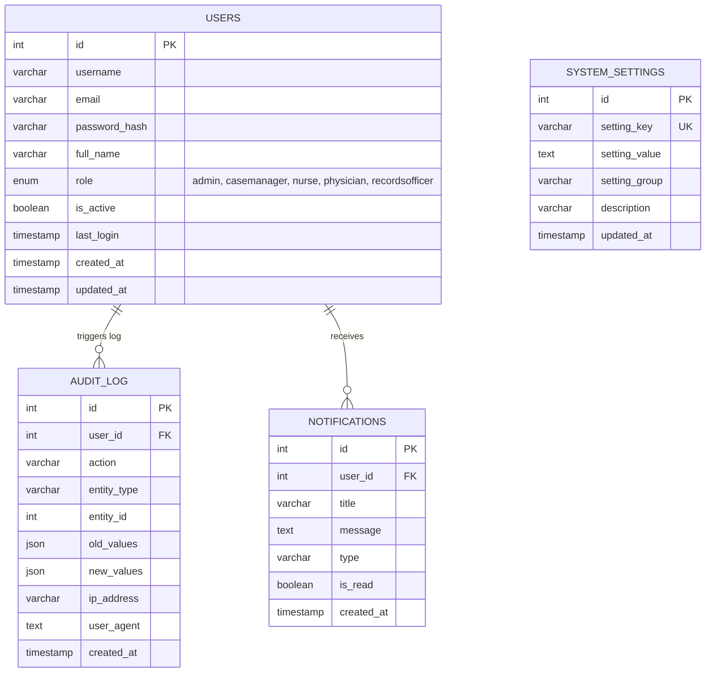
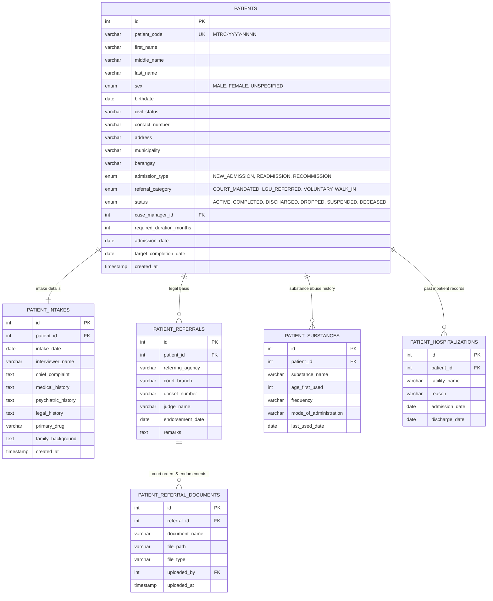
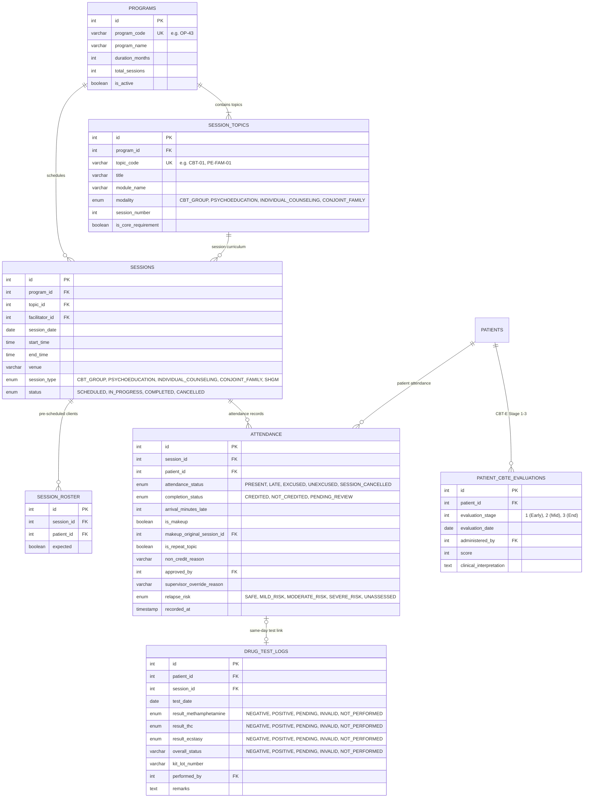

# MTRC Entrepose Outpatient Case Management & Rehabilitation System
## Database Entity Relationship Diagram (ERD) & Data Dictionary for Academic Presentation

> **Target Document**: Capstone / Thesis / Research Paper Chapter 3 (Methodology & System Architecture) or Chapter 4 (System Implementation).  
> **Database Engine**: MySQL 8.0+ / MariaDB  
> **Schema Name**: `mtrc_entrepose`  
> **Notation**: Crow's Foot ERD (Mermaid Notation)  
> **Total Entities (Tables)**: 37 tables | **Foreign Key Constraints**: 56 relationships

---

## 1. How to Present the ERD in an Academic Paper & Defense

When presenting database architecture to thesis panels, capstone advisers, or journal reviewers, **do not attempt to cram all 37 tables into a single illegible diagram**. Panels require readability, relational rigor, and traceability to clinical workflows.

### Recommended Presentation Strategy:
1. **Section 3.X.1: Core Architectural Backbone (Conceptual ERD)**: Present the central relational pipeline (`users` → `patients` → `sessions` → `attendance` → `discharges`).
2. **Section 3.X.2: Modular Subsystem ERDs (Logical ERD)**: Break down the database into 4 domain-driven subsystems:
   - **Subsystem A**: Identity, RBAC & Clinical Audit Trail
   - **Subsystem B**: Patient Master, Intake & Substance Profiling
   - **Subsystem C**: Attendance, Curriculum Credit Engine & Multi-3 Surveillance
   - **Subsystem D**: Interventions, Duration Governance, Discharges & Traceability
3. **Section 3.X.3: Formal Data Dictionary**: Tabulate the schema with primary keys (`PK`), foreign keys (`FK`), MySQL data types, nullability, and operational descriptions.

---

## 2. Core Architectural Backbone (High-Level ERD)

This diagram captures the primary clinical backbone from intake to discharge.



---

## 3. Subsystem Logical Entity Relationship Diagrams

### Subsystem A: Identity, Authentication, Role-Based Access Control (RBAC) & Governance

Enforces DOH security guidelines, strict role-based data isolation (Admin, Case Manager, Physician, Nurse, Records Officer), and comprehensive audit logging.



---

### Subsystem B: Patient Master, Legal Intake, Referrals & Clinical Baseline

Manages patient registration, court-mandated vs. voluntary triage, historical drug use profiles, and medical comorbidity documentation.



---

### Subsystem C: Attendance Engine, Curriculum Credit Separation & Multi-3 Drug Surveillance

Implements the MTRC dual-logic architecture: decoupling physical attendance recording from curriculum completion credits, supporting grace periods, supervisor overrides, and multi-panel drug testing.



---

### Subsystem D: Clinical Milestones, Interventions, Discharges, Certificates & Traceability

Ensures unalterable historical census tracking, explicit `COMPLETER` vs. `NON_COMPLETER` outcomes, and audit traceability for DOH/Dangerous Drugs Board (DDB) reporting.

```mermaid
erDiagram
    PATIENT_TREATMENT_PLANS {
        int id PK
        int patient_id FK
        int plan_version
        date start_date
        date target_end_date
        text clinical_goals
        int formulated_by FK
        timestamp created_at
    }

    PATIENT_MILESTONES {
        int id PK
        int patient_id FK
        enum milestone_code "ORIENTATION, VLTS_REFERRAL, INITIAL_ASSESSMENT, INITIAL_TREATMENT_PLAN, INITIAL_PROGRESS_REPORT, CASE_CONFERENCE, STATUS_REPORT, HOME_VISIT, FOLLOWUP_ASSESSMENT, ACP_TREATMENT_PLAN, PRE_DISCHARGE_CONF, FINAL_PROGRESS_REPORT"
        enum status "PENDING, COMPLETED, WAIVED"
        date achieved_date
        int recorded_by FK
        text remarks
    }

    PATIENT_MILESTONE_HISTORY {
        int id PK
        int patient_milestone_id FK
        varchar old_status
        varchar new_status
        int changed_by FK
        varchar reason
        timestamp changed_at
    }

    PATIENT_INTERVENTIONS {
        int id PK
        int patient_id FK
        date intervention_date
        enum category "MEDICAL_CONSULTATION, PSYCHIATRIC_EVALUATION, INDIVIDUAL_COUNSELING, FAMILY_CONFERENCE, CRISIS_INTERVENTION, PROGRESS_NOTE_ENTRY"
        int conducted_by FK
        text clinical_notes
    }

    PROGRESS_NOTES {
        int id PK
        int patient_id FK
        int session_id FK
        date note_date
        int author_id FK
        text subjective
        text objective
        text assessment
        text plan
        enum relapse_risk "SAFE, MILD_RISK, MODERATE_RISK, SEVERE_RISK, UNASSESSED"
    }

    PATIENT_DURATION_HISTORY {
        int id PK
        int patient_id FK
        int old_duration_months
        int new_duration_months
        varchar reason
        int approved_by FK
        timestamp created_at
    }

    PATIENT_CASE_MANAGER_HISTORY {
        int id PK
        int patient_id FK
        int old_case_manager_id FK
        int new_case_manager_id FK
        date effective_date
        varchar transfer_reason
        int assigned_by FK
    }

    PATIENT_STATUS_HISTORY {
        int id PK
        int patient_id FK
        varchar old_status
        varchar new_status
        date change_date
        int changed_by FK
        text reason
    }

    DISCHARGES {
        int id PK
        int patient_id FK
        date discharge_date
        enum outcome "COMPLETER, NON_COMPLETER"
        enum discharge_reason "PROGRAM_COMPLETION, VIOLATION_OF_CONTRACT, RELAPSE, TRANSFERRED, MEDICAL_REASON, ABSCONDED, COURT_ORDERED, OTHER"
        text summary_notes
        int approved_by FK
        boolean pre_discharge_conf_held
        date pre_discharge_conf_date
        timestamp created_at
    }

    CERTIFICATES {
        int id PK
        varchar certificate_type "COMPLETION, CLEARANCE, REFERRAL"
        varchar template_name
    }

    CERTIFICATE_ISSUANCES {
        int id PK
        int certificate_id FK
        int patient_id FK
        varchar certificate_number UK
        date issue_date
        int issued_by FK
        int verified_by FK
        boolean eligibility_verified
    }

    REPORT_SNAPSHOTS {
        int id PK
        varchar report_type "DOH_MONTHLY_CENSUS, DDB_EPIDEMIOLOGY, TABLE_2_0"
        int report_year
        int report_month
        json snapshot_data
        int generated_by FK
        timestamp created_at
    }

    PATIENTS ||--o{ PATIENT_TREATMENT_PLANS : "guided by"
    PATIENTS ||--o{ PATIENT_MILESTONES : "tracks 12 milestones"
    PATIENT_MILESTONES ||--o{ PATIENT_MILESTONE_HISTORY : "milestone audit"
    PATIENTS ||--o{ PATIENT_INTERVENTIONS : "clinical services"
    PATIENTS ||--o{ PROGRESS_NOTES : "SOAP clinical notes"
    PATIENTS ||--o{ PATIENT_DURATION_HISTORY : "extensions/adjustments"
    PATIENTS ||--o{ PATIENT_CASE_MANAGER_HISTORY : "transfers"
    PATIENTS ||--o{ PATIENT_STATUS_HISTORY : "status transition audit"
    PATIENTS ||--o{ DISCHARGES : "formal exit record"
    PATIENTS ||--o{ CERTIFICATE_ISSUANCES : "issued certificates"
    CERTIFICATES ||--o{ CERTIFICATE_ISSUANCES : "instance of"
```



---

## 4. Formal Data Dictionary (Key Entity Schema Tables)

Use these Markdown tables directly in Chapter 3 or Chapter 4 of your academic document.

### Table 1: `patients` (Master Patient Registry)
| Attribute | Data Type | Nullable | Key | Constraints / Enum Values | Description |
| :--- | :--- | :---: | :---: | :--- | :--- |
| `id` | `INT AUTO_INCREMENT` | No | PK | Primary Key | Unique internal client identifier. |
| `patient_code` | `VARCHAR(32)` | No | UK | Format `MTRC-YYYY-NNNN` | Official clinical record tracking number. |
| `first_name` | `VARCHAR(100)` | No | | | Patient given name. |
| `last_name` | `VARCHAR(100)` | No | | | Patient surname. |
| `sex` | `ENUM` | No | | `'MALE', 'FEMALE', 'UNSPECIFIED'` | Biological sex (defaults strictly to `UNSPECIFIED`). |
| `birthdate` | `DATE` | No | | | Date of birth for age-bracket stratification. |
| `admission_type` | `ENUM` | No | | `'NEW_ADMISSION', 'READMISSION', 'RECOMMISSION'` | DOH classification category. |
| `referral_category`| `ENUM` | No | | `'COURT_MANDATED', 'LGU_REFERRED', 'VOLUNTARY', 'WALK_IN'` | Fixed referral modality. |
| `status` | `ENUM` | No | | `'ACTIVE', 'COMPLETED', 'DISCHARGED', 'DROPPED', 'SUSPENDED'` | Current operational disposition. |
| `case_manager_id`| `INT` | Yes | FK | References `users(id)` | Current supervising case manager. |
| `required_duration_months`| `INT`| No | | Default: 6 | Prescribed rehabilitation program duration. |
| `admission_date` | `DATE` | No | | | Date of formal program admission. |

---

### Table 2: `attendance` (Physical Presence vs. Curriculum Credit)
| Attribute | Data Type | Nullable | Key | Constraints / Enum Values | Description |
| :--- | :--- | :---: | :---: | :--- | :--- |
| `id` | `INT AUTO_INCREMENT` | No | PK | Primary Key | Unique attendance transaction record. |
| `session_id` | `INT` | No | FK | References `sessions(id)` | Scheduled curriculum session. |
| `patient_id` | `INT` | No | FK | References `patients(id)` | Enrolled outpatient participant. |
| `attendance_status`| `ENUM`| No | | `'PRESENT', 'LATE', 'EXCUSED', 'UNEXCUSED', 'SESSION_CANCELLED'` | Physical presence at scheduled time. |
| `completion_status`| `ENUM`| No | | `'CREDITED', 'NOT_CREDITED', 'PENDING_REVIEW'` | Whether session satisfies curriculum topic. |
| `arrival_minutes_late`| `INT`| Yes| | Default: 0 | Minutes past scheduled commencement. |
| `is_makeup` | `TINYINT(1)` | No | | Default: 0 | Flags make-up session for prior absence. |
| `makeup_original_session_id`| `INT`| Yes| FK | References `sessions(id)` | Preserves original missed denominator. |
| `is_repeat_topic`| `TINYINT(1)`| No | | Default: 0 | Prevents duplicate curriculum credit. |
| `non_credit_reason`| `VARCHAR(255)`| Yes| | Free text | Required if attendance is not credited. |
| `approved_by` | `INT` | Yes | FK | References `users(id)` | Clinical supervisor authorizing override. |
| `relapse_risk` | `ENUM` | No | | `'SAFE', 'MILD_RISK', 'MODERATE_RISK', 'SEVERE_RISK', 'UNASSESSED'` | Relapse risk assessment at attendance. |

---

### Table 3: `drug_test_logs` (Multi-3 Substance Surveillance)
| Attribute | Data Type | Nullable | Key | Constraints / Enum Values | Description |
| :--- | :--- | :---: | :---: | :--- | :--- |
| `id` | `INT AUTO_INCREMENT` | No | PK | Primary Key | Unique drug testing transaction. |
| `patient_id` | `INT` | No | FK | References `patients(id)` | Tested patient. |
| `session_id` | `INT` | Yes | FK | References `sessions(id)` | Associated clinical session (if during attendance). |
| `test_date` | `DATE` | No | | | Date test sample was collected. |
| `result_methamphetamine`| `ENUM`| No | | `'NEGATIVE', 'POSITIVE', 'PENDING', 'INVALID', 'NOT_PERFORMED'` | Screening result for Methamphetamine (Shabu). |
| `result_thc` | `ENUM` | No | | `'NEGATIVE', 'POSITIVE', 'PENDING', 'INVALID', 'NOT_PERFORMED'` | Screening result for Cannabinoids (Marijuana). |
| `result_ecstasy` | `ENUM` | No | | `'NEGATIVE', 'POSITIVE', 'PENDING', 'INVALID', 'NOT_PERFORMED'` | Screening result for MDMA (Ecstasy). |
| `overall_status` | `VARCHAR(32)` | No | | Calculated | Summary disposition across all 3 analytes. |
| `kit_lot_number` | `VARCHAR(64)` | Yes | | | Rapid test kit batch lot number. |
| `performed_by` | `INT` | No | FK | References `users(id)` | Certified nurse or medical technologist. |

---

### Table 4: `discharges` (Program Exit Disposition & Traceability)
| Attribute | Data Type | Nullable | Key | Constraints / Enum Values | Description |
| :--- | :--- | :---: | :---: | :--- | :--- |
| `id` | `INT AUTO_INCREMENT` | No | PK | Primary Key | Unique discharge exit log. |
| `patient_id` | `INT` | No | FK | References `patients(id)` | Discharged patient. |
| `discharge_date` | `DATE` | No | | | Official date of exit from program. |
| `outcome` | `ENUM` | No | | `'COMPLETER', 'NON_COMPLETER'` | Strict binary classification for Table 2.0 / DOH. |
| `discharge_reason` | `ENUM`| No | | `'PROGRAM_COMPLETION', 'VIOLATION_OF_CONTRACT', 'RELAPSE', 'TRANSFERRED', 'MEDICAL_REASON', 'ABSCONDED', 'COURT_ORDERED', 'OTHER'` | Specific clinical or administrative reason. |
| `summary_notes` | `TEXT` | Yes | | | Comprehensive case manager summary. |
| `approved_by` | `INT` | No | FK | References `users(id)` | MTRC Center Chief / Designated Supervisor. |
| `pre_discharge_conf_held`| `TINYINT(1)`| No| | Default: 0 | Verifies actual occurrence of Pre-Discharge Conf. |
| `pre_discharge_conf_date`| `DATE`| Yes| | Nullable | Date conference was physically conducted. |

---

## 5. Step-by-Step Instructions: Exporting for Paper & Defense

### Option A: Microsoft Word / Google Docs
1. Visit the open-source Mermaid Live Editor at: **[https://mermaid.live](https://mermaid.live)**.
2. Copy any of the `mermaid` code blocks above and paste it into the left editor pane.
3. Click the **Download** button in the bottom left:
   - Select **PNG (High Quality / 300 DPI)** for general documents.
   - Or select **SVG (Vector)** for crisp scaling without pixelation.
4. In Word: Click `Insert` → `Pictures` → `This Device...` → Select the downloaded file.
5. Add a formal academic caption below the figure:
   > **Figure 3.4.** *Entity Relationship Diagram for MTRC Entrepose Curriculum and Attendance Credit Subsystem.*

### Option B: LaTeX / Overleaf
1. In Mermaid Live Editor, export the diagram as `figure_erd_core.png` or `figure_erd_core.pdf`.
2. Upload the file to your Overleaf project folder (e.g. `images/`).
3. Insert into your `.tex` file using the standard figure float:

```latex
\begin{figure}[htbp]
    \centering
    \includegraphics[width=0.95\textwidth]{images/figure_erd_core.png}
    \caption{Entity Relationship Diagram (ERD) of MTRC Entrepose Clinical Backbone}
    \label{fig:erd_core}
\end{figure}
```

### Option C: Oral Defense Presentation Slides (PowerPoint / Keynote / Google Slides)
1. **Never put all 37 tables on one slide**. The defense committee cannot read small 6pt text.
2. Structure your database slides across **3 distinct slides**:
   - **Slide 1: High-Level Conceptual ERD**: Show the 6 main boxes (`USERS`, `PATIENTS`, `SESSIONS`, `ATTENDANCE`, `DRUG_TEST_LOGS`, `DISCHARGES`) to illustrate the clinical flow from admission to completion.
   - **Slide 2: Technical Highlight — Attendance vs. Completion Separation**: Show the `ATTENDANCE` and `SESSION_ROSTER` relationship and explain how unrecorded rosters preserve denominator integrity, makeup linking prevents double-counting, and late-arrival overrides require supervisory approval.
   - **Slide 3: Surveillance & Historical Traceability**: Show `DRUG_TEST_LOGS` (Multi-3 panel results) and `DISCHARGES` (strict `COMPLETER` vs. `NON_COMPLETER` enum mapping directly to DOH Table 2.0).

---

*Authored for the MTRC Outpatient Rehabilitation Information System research documentation.*
